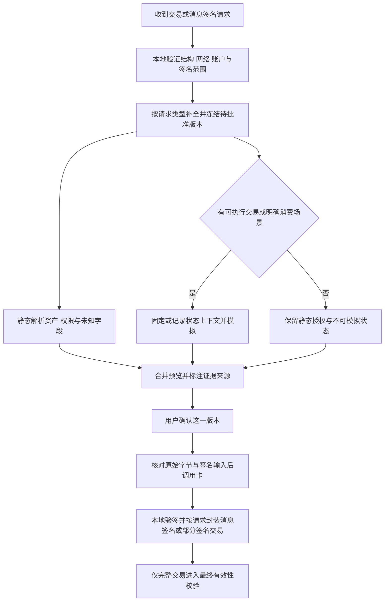

# 交易结果模拟：EVM、Bitcoin、Solana

调研日期：2026-10-14。本文优先回答“签名前能否告诉用户执行后会发生什么”。结论基于官方规范、RPC 文档与公开源码，未调用付费模拟端点、未发送交易；下面的选型是建议，性能和覆盖率尚未实测。

## 推荐方向

采用**本地解析 + 链上状态模拟 + 本地结果校验**的组合。模拟是核心预览来源，同时保留静态的授权范围、签名覆盖范围和未知字段。单独的余额变化不能解释无限授权、账户接管、离线订单等未来影响。

对 Monoid 的第一版，建议 EVM 用 Tenderly 做候选主服务，以 Geth 的标准/扩展 RPC 做对照；Solana 先用标准 `simulateTransaction`；BTC 先做 PSBT/UTXO 收支计算，再用 Bitcoin Core 的钱包余额模拟和 mempool 校验补充。服务选型需用同一批样例比较后确定。

## 三条链可以得到什么

| 链      | 签前可用输入                                                                   | 可预览结果                                                                         | 不能据此保证                                                           |
| ------- | ------------------------------------------------------------------------------ | ---------------------------------------------------------------------------------- | ---------------------------------------------------------------------- |
| EVM     | 完整 transaction call，包括 sender、网络、calldata、value、gas、fees、nonce 等 | 成功/回滚、调用树、logs、gas、状态差分；进一步解释余额、NFT、allowance 等          | 真正上链顺序、将来价格、跨链最终交付；任意签名消息都可执行             |
| Solana  | 序列化 transaction，含原始 message、静态账户及 ALT 上下文                      | err、logs、CPI、计算量；节点支持时返回费用和 pre/post balances；指定账户执行后状态 | 跳过验签的交易已获全部签名；相同 blockhash 就代表执行状态不变          |
| Bitcoin | PSBT/raw tx + 可核对的 prevouts + 自己的钱包 descriptor                        | 每个输出、归属、支出/找零、绝对手续费；Core 可估钱包余额影响                       | 未签完 PSBT 的脚本有效性、未来被矿工收录、所有 Ordinals/Runes 资产归属 |

依据：[Geth eth_simulateV1](https://geth.ethereum.org/docs/interacting-with-geth/rpc/ns-eth)、[Solana simulateTransaction](https://solana.com/docs/rpc/http/simulatetransaction)、[Bitcoin Core simulaterawtransaction](https://bitcoincore.org/en/doc/30.0.0/rpc/wallet/simulaterawtransaction/)。详细的链内限制见 [EVM](evm.md)、[BTC](bitcoin.md)、[Solana](solana.md)。

## EVM：从执行轨迹到用户结果

### 节点能力的区别

| 方法                                               | 主要结果                                                | 对钱包的价值与限制                                                          |
| -------------------------------------------------- | ------------------------------------------------------- | --------------------------------------------------------------------------- |
| `eth_call`                                         | 返回值或 revert                                         | 验证某个调用在给定状态下能否运行；通常不返回完整资产变化                    |
| `eth_estimateGas`                                  | gas 估算                                                | 估费输入，不能视为资产/权限解析器                                           |
| `debug_traceCall` + `callTracer`                   | 调用树、输入输出、错误，可选日志                        | 发现内部调用、delegatecall、失败路径；需要独立业务解释                      |
| `debug_traceCall` + `prestateTracer` 的 `diffMode` | 修改前后账户/存储槽                                     | 可定位原始状态变化；存储槽本身不自动等于 ERC-20 余额/授权                   |
| `eth_simulateV1`                                   | 按顺序执行的 calls/blocks、每步成功/失败状态、gas、日志 | 支持依赖前序状态的模拟；不直接等同完整状态差分；具体节点/供应商需要探测支持 |

`eth_simulateV1` 的 `validation=true` 仍跳过部分发送者/签名检查。`traceTransfers` 会生成用于表达原生 ETH 转移的特殊日志，显示层必须识别其来源，不当成普通合约真实发出的 ERC-20 事件。[Geth RPC](https://geth.ethereum.org/docs/interacting-with-geth/rpc/ns-eth)、[Geth tracers](https://geth.ethereum.org/docs/developers/evm-tracing/built-in-tracers)、[Execution APIs 规范](https://ethereum.github.io/execution-apis/api/methods/eth_simulateV1/)。

以上是执行引擎能力。Monoid 还需要自己的解释规则：按链和合约地址识别资产，把原始整数转换成金额，合并同一用户多个账户的变化，区分 gas、转账、授权和业务操作。不要只汇总 `Transfer` 日志：恶意合约可发误导事件，非标准 token 也可能没有符合预期的事件。

### 必须展示的影响

- 资产：原生币、ERC-20、ERC-721/1155 的净变化，同时保留对手方和转移明细；不要把“转出后转入”的净零当作无影响。
- 权限：allowance、operator、Permit/Permit2 的 spender、额度、期限、nonce；余额不变仍可能授权未来转走资产。
- 账户控制：7702 delegation、Safe owner/threshold/module、session key 等已识别的控制权变更。未知 storage change 应保留“未解释”状态。
- 费用：执行 gas 估算、用户批准的上限和最终实际费用分开；L2 额外费用由链适配器解释，不直接套用主网公式。
- 错误：RPC 错误、执行 revert、部分解析和模拟超时各自表达。回滚中的 trace/log 不能按已发生转账展示。

这些是本研究建议的结果模型；现有 RPC 不自动提供所有业务字段。

### 消息签名不是现成交易

`personal_sign` 登录消息和一般 EIP-712 数据没有统一执行入口。对于 permit、订单、SafeTx、UserOperation，需要识别具体协议、执行合约、调用者、消费参数和部署版本，才可能构造消费场景。

签名前还没有可用签名时，模拟平台可能跳过验证、覆盖状态或提供特定协议建模。这类结果应明确标记为“基于假设的场景”，不能声称完整验证了签名消费。签名也可能在以后、不同状态下被使用，因此应同时显示静态授权的最大范围，而非只显示一次模拟的净支出。规范入口见 [EIP-2612](https://eips.ethereum.org/EIPS/eip-2612)、[Permit2](https://docs.uniswap.org/contracts/permit2/overview)、[ERC-4337](https://eips.ethereum.org/EIPS/eip-4337)。

## Solana：同一 message、同一状态上下文

签前通常可以关闭 `sigVerify` 来模拟未签完交易，但这只是执行预览。刷新 blockhash、增删 Compute Budget 指令、修改 fee payer 或账户列表都会改变签名字节；必须重新计算预览与签名计划。`replaceRecentBlockhash` 是模拟选项，不能偷偷把模拟中的替换当成原交易已更新。

本次查阅的官方 RPC 示例已包含 `fee`、`preBalances/postBalances`、`preTokenBalances/postTokenBalances`、`loadedAddresses`。实际端点可能采用不同节点版本，应探测字段与错误语义，不以旧教程断言这些字段永远不存在，也不假定所有端点都支持。[官方 RPC](https://solana.com/docs/rpc/http/simulatetransaction)。

如果只有执行后 `accounts`，另行 `getMultipleAccounts` 得到的执行前状态不一定与模拟属于同一 bank。`minContextSlot` 是状态新鲜度下限，不等于固定快照。此时要显示证据局限，或选择能提供同一快照前后状态的服务。资产变化还需覆盖 ATA 新建/关闭、rent、wrapped SOL、delegate/authority 变化和 Token-2022 扩展；只读日志不够。

多个 transaction 的 `signAllTransactions` 既不代表原子 bundle，也不代表并行发出就按签名顺序执行。相互依赖时需要共享可变状态的顺序模拟：

- Quicknode 的 `simulateBundle` 属于 Lil' JIT 插件能力，文档说明需要启用对应 add-on；它不是通用 Solana 标准 RPC。[官方接口](https://www.quicknode.com/docs/solana/simulateBundle)
- Alchemy 当前另有 `simulateTransactionsAtSlot` 文档，描述最多五笔在共享 overlay 上顺序执行。这是供应商扩展，不应按所有 RPC 均支持设计。[官方接口](https://www.alchemy.com/docs/chains/solana/solana-api-endpoints/simulate-transactions-at-slot)

模拟 bundle 成功也不自动赋予普通广播原子性。必须让预览使用的执行方式与最终提交方式一致。

## Bitcoin：收支推导、钱包模拟、有效性检查

Bitcoin 的主要问题是“哪些 UTXO 被花掉，生成哪些输出，谁拥有它们”。对 prevout 金额、script 和本地 descriptor 核对后，很多结果可以精确静态推导。

`simulaterawtransaction` 可以针对已登记在 Bitcoin Core 钱包中的地址/descriptor 估算钱包余额变化，适合 watch-only 钱包作为参照。它不是 EVM 式合约模拟器，也不能证明缺失签名的输入可以花费。`testmempoolaccept` 则检查完成的 raw tx 是否满足当前节点的共识和策略条件；不要用它替代 PSBT 签前解析。[Core 钱包 RPC](https://bitcoincore.org/en/doc/30.0.0/rpc/wallet/simulaterawtransaction/)、[Core mempool RPC](https://bitcoincore.org/en/doc/30.0.0/rpc/rawtransactions/testmempoolaccept/)。

找零归属必须由可信登记的完整钱包策略重建并核对 scriptPubKey；单独派生路径不足以验证多签或 Taproot 策略。钱包净余额变化和全交易手续费分别计算；CoinJoin 等多方交易无法只凭全局输入总额认定用户支付了全部手续费。未完成 witness 时绝对手续费可在 prevout 齐全后算出，最终 vsize/费率仍可能是估值。

Ordinals、Runes 和其他索引资产不在普通 BTC 金额层内；如产品要保护这些资产，需要独立索引与 sat/协议规则。UTXO 在预览后仍可能被竞争花费；“当前可接受”不保证被收录。

## 服务和部署方案比较

| 方案                                      | 适合用途                                           | 已核实依据                                                                                                                                                                                                                                 | 当前限制与取舍                                                                                          |
| ----------------------------------------- | -------------------------------------------------- | ------------------------------------------------------------------------------------------------------------------------------------------------------------------------------------------------------------------------------------------ | ------------------------------------------------------------------------------------------------------- |
| Tenderly                                  | EVM 主模拟候选：单笔、bundle、trace、资产/状态变化 | [Overview](https://docs.tenderly.co/simulations/overview)、[单笔 API](https://docs.tenderly.co/api-reference/simulator/simulate-transaction)、[bundle API](https://docs.tenderly.co/api-reference/simulator/simulate-bundled-transactions) | 后端集成快；链、方法、字段与套餐需逐项验证；不在移动端嵌长期服务密钥                                    |
| 自建 Geth/其他支持相应方法的执行客户端    | 固定状态重放、可控 trace、服务对照                 | [Geth RPC](https://geth.ethereum.org/docs/interacting-with-geth/rpc/ns-eth)                                                                                                                                                                | 节点、历史状态、链升级和业务解释都需维护；一种客户端不能代表所有 EVM 链                                 |
| Blockaid                                  | 跨链风险与交易预览候选                             | [官方产品页](https://blockaid.io/transaction-security) 列出 Ethereum/Solana/Bitcoin，并声明 EIP-712、4337、bulk                                                                                                                            | 文档入口本次跳登录，未核实各链 endpoint/PSBT/具体策略/价格；营销覆盖不能当接口覆盖                      |
| 标准 Solana RPC                           | 单笔签前执行预览                                   | [simulateTransaction](https://solana.com/docs/rpc/http/simulatetransaction)                                                                                                                                                                | 需本地解码、账户归属与版本探测；共享 snapshot、批量能力另核验                                           |
| Quicknode Lil' JIT / Alchemy Solana 扩展  | 多笔顺序执行、特定快照/前后账户结果                | 上述两份官方接口文档                                                                                                                                                                                                                       | 有供应商/套餐和方法限制；本次未实调用，不给出延迟或可用性结论                                           |
| Bitcoin Core + descriptor/watch-only 钱包 | BTC 本地结果对照与完成后的有效性检查               | 上述 Core 30.0.0 RPC 文档                                                                                                                                                                                                                  | 不自带 token/铭文业务解释；需管理钱包描述符与链状态                                                     |
| LiteSVM / Mollusk                         | Solana 本地样例重放、程序级回归和研究              | [LiteSVM](https://github.com/LiteSVM/litesvm)、[Mollusk](https://github.com/anza-xyz/mollusk)                                                                                                                                              | 主要是测试/执行基础设施；账户、程序、sysvar、feature set 一致性由集成方负责，不能直接当实时主网预览服务 |

Alchemy 的 EVM `simulateExecution` 等官方 SDK 资料仍可检索，但本次部分旧 endpoint/quickstart 链接跳到了 Data API 首页或取不到正文；当前套餐与端点可用性未确认，暂不作为首选依据。[仍可访问的 SDK 参考](https://www.alchemy.com/docs/reference/simulateexecution-sdk)。Blowfish 的旧 SDK/接口资料可见，但文档入口本次无法访问，保留为后续候选，不推断其停服或完整可用。

不引用供应商宣传延迟作为性能证据。成本应测“每次确认页产生的请求数 × 单次模拟/trace/账户读取成本”，同时计入重试、用户改 gas 后的重算、批量交易和异常合约的资源消耗。

## 推荐的预览流程

这是职责划分建议，不是已批准或实现的 App/API 接口。模拟后交易字段发生变化时回到冻结/预览阶段；仅新状态到来时，也应判断金额、费用、权限、可执行性等是否发生实质变化并要求重新确认。部分签名 PSBT 可以返回请求方，但不能当作已 finalize 的完整交易调用 mempool 接受性检查；是否广播由请求方法和授权范围决定。

### 结果必须保留的证据

| 信息                                                        | 用途                                              |
| ----------------------------------------------------------- | ------------------------------------------------- |
| 请求身份、链、账户、输入内容指纹、签名覆盖范围              | 防止旧请求/其他账户的模拟结果被复用               |
| 实际模拟输入与实际签名输入的映射                            | 区分未签名 call、PSBT、message、最终广播 envelope |
| block hash/number 或 slot、commitment、节点/引擎版本、时间  | 表达预览基于哪个状态；slot 本身不是不可变状态证明 |
| 是否跳过验签、替换 blockhash、改 balance/nonce/code/storage | 让正常预览与假设场景可区分                        |
| 资产变化、权限变化、费用、未知影响各自的证据和覆盖度        | 避免一个“success”隐藏未解析行为                   |
| provider 错误与执行错误分别记录                             | 区分服务失败和交易会失败                          |

金额使用精确整数和 decimals；符号、图标、价格是外部元数据，不能替代链/合约/mint 标识。状态建议至少区分“成功且在覆盖范围内”“成功但部分未知”“执行失败”“未支持”“不可用”“结果过期”。这属于产品语义建议。

### 不能直接得到保证的场景

- MEV、滑点、预言机、区块时间与打包顺序变化；签名前模拟只能提供条件性的结果。
- 合约/程序升级、恶意环境分支、第三方 RPC 返回伪造状态；provider 结果也需要明确来源。
- 消息签名未来多次消费、无限授权、跨链桥的目的链执行；单次本链模拟无法穷尽。
- 浏览器/App 自己被控制：手机显示与卡端 digest 一致性的应用检查不能替代独立可信显示屏。

## 后续 PoC：以结果正确性决定服务

本次仅定义验收样例，不声称已跑通。第一轮可以完全采用公开测试向量、本地 fork/devnet 与测试钥匙，不需要用户真实资产。

| 类别          | 必测样例                                                             | 关键验收                                                              |
| ------------- | -------------------------------------------------------------------- | --------------------------------------------------------------------- |
| EVM 常用路径  | 原生币、ERC-20、NFT、swap、先 approve 再 swap                        | 资产、手续费、授权与同状态执行结果一致                                |
| EVM 危险边界  | 无限 approve、Permit2、伪造 Transfer、revert、proxy 升级、7702、4337 | 零余额变化仍显示权限影响；不支持的类型明确拦下                        |
| Solana        | SOL、ATA 创建/关闭、SPL、Token-2022、ALT、CPI、authority 变更        | 账户归属、rent/fee、权限及 token 变化无遗漏；失败 null 不当作关闭账户 |
| BTC           | P2WPKH/P2TR、混合输入、多方 PSBT、未知找零、sighash 变体             | 输出/fee/归属正确；签名范围和“还能改什么”可见                         |
| 批量/并发     | 有状态依赖的两笔、失败后下一笔、旧异步响应晚到                       | 按最终提交语义模拟；结果只能绑定对应请求版本                          |
| 状态/服务故障 | stale block、expired blockhash、spent UTXO、超时、字段缺失           | 不把 unavailable/partial 转成“没有风险”                               |

比较指标建议为：资产/权限漏报率、未知率、错误分类、固定状态重放一致率、p50/p95/p99 延迟、每次确认成本、数据保存策略、版本升级后的回归差异。不同引擎不一致时先保留两份证据并定位输入/状态/规则差异，再决定采用哪一个结果。
